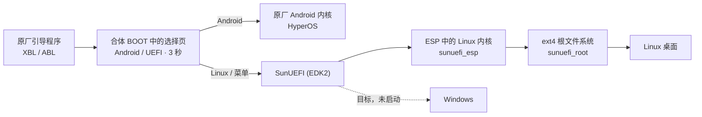

# Project SunUEFI

小米平板 8 Pro（`piano`，骁龙 8 至尊版 / SM8750）的 EDK2 UEFI 固件、主线 Linux 内核和桌面系统适配。
目标是通过统一的 UEFI 获得完整的 Linux 与 Windows 体验，同时保留原厂 Android。Linux 已经能用，Windows 还没有启动。

这块平板的硬件不差，出厂却只能跑 HyperOS。我们给它加了一套自己的 UEFI，让它能从内部存储启动 Debian、Nyarch 或 SteamOS，想回 Android 随时可以回，Android 数据和原厂 Recovery 都保留。

[快速开始](#快速开始) · [支持的硬件](#支持的硬件) · [已知问题](docs/user/known-issues.md) · [故障恢复](docs/user/recovery.md) · [尚未完成](#尚未完成)

## 开机时发生什么

原厂 Android 内核留在原位，SunUEFI 只把内核的入口改向一个小选择器，再把选择器和 UEFI 接在内核后面一起加载。这个整体叫合体 BOOT：选择 Android 进入 HyperOS，选择 UEFI 启动 Linux 或进入固件菜单，小米原厂的 Recovery 照常可用。选择页停留约三秒，音量键切换，短按电源确认，没有操作就沿用保存的选择。原理见[合体 BOOT](docs/devel/boot/combined-boot.md)。



### 启动路线会被记住

在助手里保存的选择是默认启动路线，开机时用音量键临时改选不会改动它。首次安装默认进入 Android。在 Linux 里运行 `piano-next-boot android --reboot` 回到 Android，`reboot recovery` 进入原厂 Recovery 且不改动保存的路线。HyperOS 更新后，在助手的 **维护** 页点 **重新安装引导**。

### UEFI Fastboot

UEFI 运行时，后台常驻一个 USB Fastboot 服务（设备名 `SunUEFI-piano`）。即使屏幕没有画面，也能从电脑读日志、导出截图、只读读取分区，或请求启动 Linux。它和另外两个容易混淆的东西不同，命令见 [UEFI Fastboot](docs/user/fastboot.md)。

| 名称 | 什么时候出现 | 能做什么 |
| --- | --- | --- |
| 原厂 Bootloader Fastboot | 开机时按键进入，或 `adb reboot bootloader` | 小米原厂功能，可刷写分区 |
| UEFI Fastboot（本项目） | SunUEFI 运行期间 | 日志、截图、只读读取、请求启动；不支持刷写和擦除 |
| Linux 的 USB 网络 / SSH | Linux 启动之后 | 普通的 Linux 远程登录与调试 |

### 同一个 UEFI 核心

项目只维护一份 UEFI 核心 `PianoUEFI-product.img`。合体 BOOT、`fastboot boot` 临时启动和安装器用的都是它，不再按功能拆成多套测试镜像。只想试运行、不改动平板时，下载 `SunUEFI-UEFI-Fastboot`，见[临时启动](docs/user/temporary-boot.md)。

## 实机画面

| | |
| --- | --- |
| <br>开机选择 | <br>UEFI 启动画面 |
| <br>Debian / GNOME 与相机 | <br>Android 引导助手 |


| Minecraft · Vulkan / Turnip | Minecraft · OpenGL / Freedreno |
| --- | --- |
|  |  |

两张均为原版 Minecraft 26.3，无优化模组，在平板 3K 屏幕上运行。照片分别显示约 446 FPS 和 174 FPS，为不同场景的瞬时读数。Vulkan 的分辨率显示差异可能与驱动 bug 或 Wayland 缩放有关。

### SteamOS 与游戏

| Steam 游戏模式 | 原神 · 游戏内 |
| --- | --- |
|  |  |
| **原神 · 官方启动器** | **魔法少女的魔女审判** |
|  |  |

## 支持的硬件

| 功能 | 状态 | 说明 |
| --- | --- | --- |
| 显示 | ✅ | 3200×2136，默认 120 Hz，可切换刷新率，十位输出 |
| HDR 内容 | ✅ | 可播放 |
| 12-bit / FRC、连续 VRR | ❌ | 未实现 |
| GPU | ✅ | Adreno，Vulkan（Turnip）和 OpenGL（Freedreno）。部分 GTK 窗口连续缩放时帧率偏低 |
| 触屏 | ✅ | 点按、拖动、长按、手势，约 144 Hz |
| 官方键盘与触控板 | ✅ | 含键盘背光，F1–F12 用右 Ctrl 加数字键，见[键盘说明](docs/user/keyboard.md) |
| 触控笔（Xiaomi Focus Pen，P81C） | ⚠️ | 定位、压感、轻捏、震动、磁吸恢复可用。完整掌压、笔身滑动、快捷手势未完成 |
| 扬声器与麦克风 | ✅ | 四扬声器，原生单声道录音 |
| Wi-Fi / 蓝牙 | ✅ | |
| 相机 | ✅ | 前后预览、录像、自动曝光和对焦，摄像头工作时实体绿灯亮起 |
| 闪光灯 | ⚠️ | 接口已注册，实际发光未观察 |
| 传感器与自动亮度 | ✅ | 自动旋转、光线、距离、罗盘 |
| 夜灯 | ✅ | 使用通用 sRGB 配置，不是原厂校准 |
| 电源 | ✅ | 双电池、PD 充电、合盖、挂起与唤醒。不支持休眠 |
| USB（Linux） | ✅ | Type-C 方向和角色切换，5 Gbit/s USB 网络 |
| 视频编解码 | ✅ | Iris + V4L2，带补丁的 FFmpeg |
| SteamOS / Proton / FEX | ✅ | 游戏模式和桌面模式可用，支持常见 Windows 游戏（部分游戏需游戏自身参数，如原神） |
| UEFI 阶段的触屏、键盘、USB Host | ❌ | 菜单用音量键和电源键操作 |
| 指纹 | ⚠️ | 底层已接入，用户空间录入与认证未验证 |
| 红外发射 | ❌ | 未验证 |
| Windows / WinPE | ❌ | 目标，未启动 |

测试设备是 CSOT 面板、16 GB 内存的 `25091RP04C`，其他面板和内存容量没有测试过。各项的细节见[项目状态](docs/status.md)。

### 尚未完成

* 12-bit / FRC、连续可变刷新率（VRR）
* 触控笔完整掌压、笔身滑动及应用快捷手势
* 指纹录入与认证（底层已接入，未验证）
* 红外发射
* UEFI 阶段的触屏、官方键盘与 USB Host
* Windows / WinPE 启动

## 快速开始

### 在平板上安装

> [!NOTE]
> 需要 Bootloader 已解锁、已安装 KernelSU 或 SukiSU 的小米平板 8 Pro，并提前备份数据。

1. 从 [Build products](https://github.com/slwyts/Project-SunUEFI/actions/workflows/build-products.yml) 下载三个包：引导助手模块（`SunUEFI-Module`）、启动镜像（ESP，`SunUEFI-ESP`）和系统镜像（root，`SunUEFI-Root-发行版`）。
2. 在模块管理器里安装模块并重启，点击模块卡片上的 **打开 WebUI**，打开引导助手。
3. 在 **存储** 页点 **创建独立分区**，选好容量后确认并重启。已有独立分区时跳过这一步。
4. 在 **存储** 页选择下载好的启动镜像和系统镜像，点 **安装所选镜像**。
5. 在 **启动** 页选择 **UEFI** 和 **Linux**，点 **保存并重启**。

> [!WARNING]
> 新平板的首次分区还没有在设备上验证过，见[已知问题](docs/user/known-issues.md#首次分区)。

系统镜像有 `debian-gnome`、`debian-kde`、`nyarch-gnome` 和 `steamos` 四种。首次启动会自动把根文件系统扩展到分区大小，耗时比后续启动长。用户名 `piano`、密码 `piano123456` 登录，系统默认自动登录，锁屏解锁和 `sudo` 用同一个密码。完整步骤见[安装指南](docs/user/getting-started.md)。

### 自己构建

需要 x86_64 或 ARM64 的 Linux 加 Docker，完整系统镜像需要 ARM64 构建机和特权容器。

```sh
./build.sh sources   # 取固定版本的上游源码
./build.sh check     # 主机检查
./build.sh uefi      # 产物在 artifacts/product/PianoUEFI-product.img
```

容器用法、各发行版的构建命令和产物位置见[构建手册](docs/devel/building.md)。

## 仓库结构

```
uefi/        EDK2 平台、产品核心、启动交接代码
linux/       内核配置、设备树、BSP、桌面和发行版配方、用户空间程序
android/     引导助手模块（WebUI）和 Android 侧原生工具
patches/     对 Linux、固件、Gamescope 等上游的补丁
tools/       构建、打包、检查脚本，入口是 ./build.sh
config/      发布配置（内核版本、固件、发行版）
upstream/    固定提交的上游源码（子模块），不直接修改
vendor/      板级输入文件
tests/       主机端测试
docs/        文档
```

## 文档

[用户文档](docs/user/getting-started.md) · [开发文档](docs/README.md) · [项目状态](docs/status.md) · [第三方来源](THIRD_PARTY.md) · [许可](LICENSE.md) · [贡献指南](CONTRIBUTING.md) · [AI 协作规范](AGENTS.md)

## 站在谁的肩膀上

上游源码固定在 `upstream/`，我们的修改放在 `patches/`、`uefi/`、`linux/` 和构建工具里。UEFI 部分基于 [EDK2](https://github.com/tianocore/edk2) 和 [Mu-Silicium](https://github.com/Project-Silicium/Mu-Silicium)，启动菜单来自 [simple-init](https://github.com/BigfootACA/simple-init)。内核从 [linux-piano](https://github.com/blu-sharky/linux-piano) 起步，Debian 根系统来自 [debian-piano](https://github.com/blu-sharky/debian-piano)，设备固件来自 [piano-firmware](https://github.com/blu-sharky/piano-firmware)，图形用户空间来自 [piano-mesa](https://github.com/blu-sharky/piano-mesa)。完整列表和各项目承担的部分见[上游项目](docs/devel/upstreams.md)。
