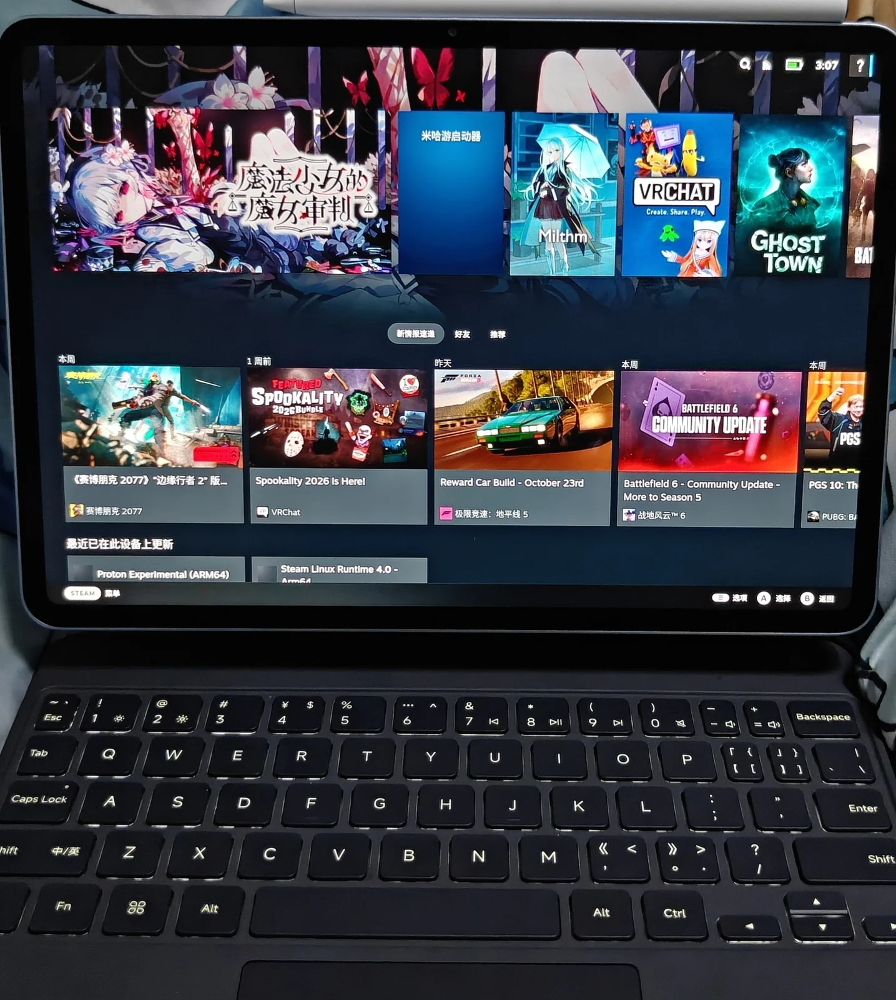
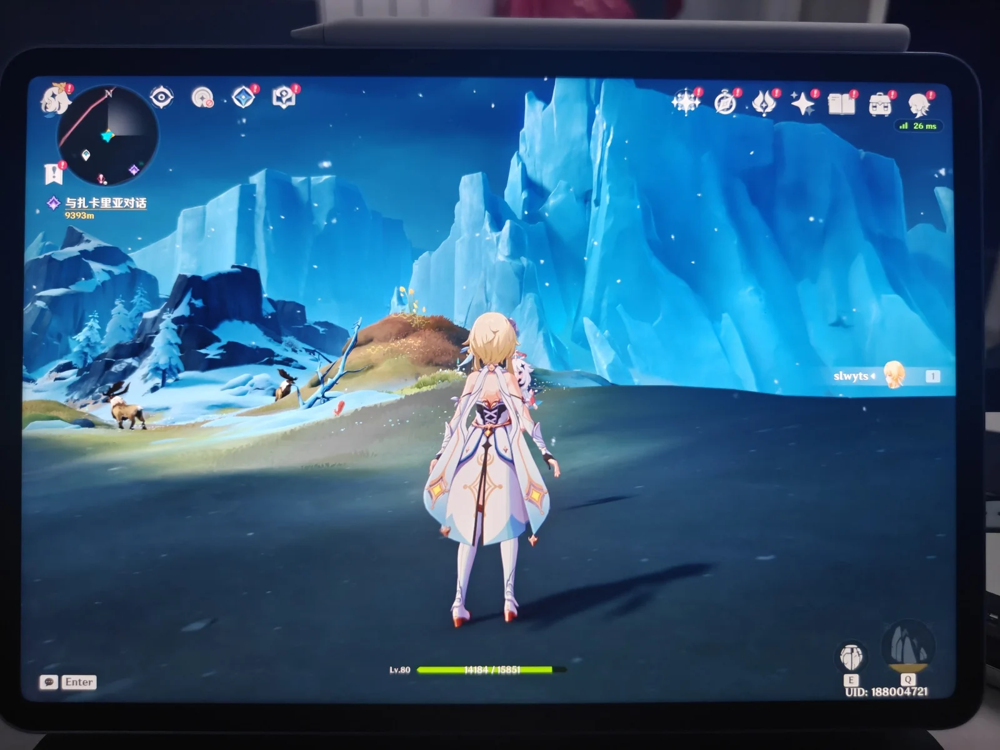
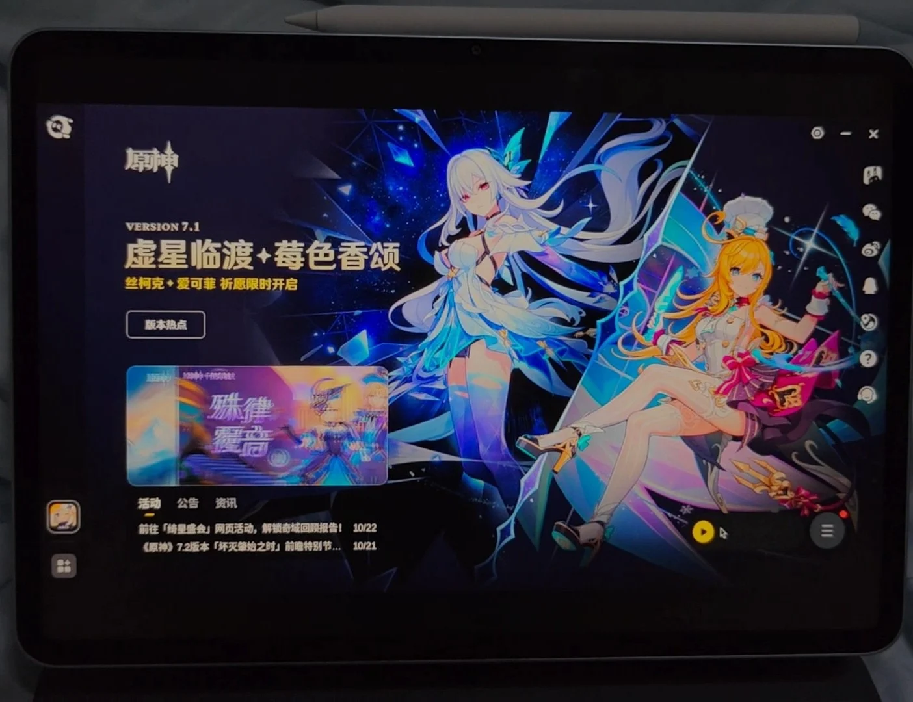
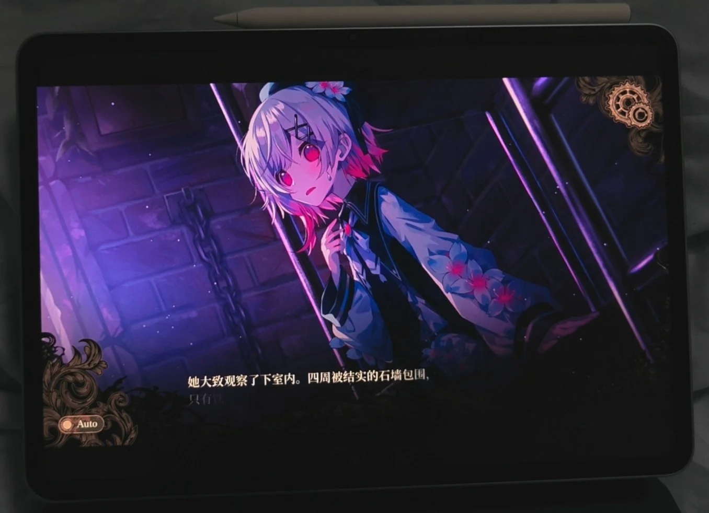

# SteamOS ARM64

这一目标使用 Valve SteamOS ARM64 根系统，沿用 SunUEFI 的合体 BOOT、UEFI、内核、设备树和独立存储分区。无需替换 ABL，也不使用 SteamOS-ARM-Port 的掌机分区安装器。

这是实验构建目标。默认启动入口为 **Steam Gaming Mode**，KDE 作为桌面模式。
游戏模式显示、输入以及 KDE 之间的模式切换可用。Milthm 与原神可运行；
Proton/FEX 的兼容性仍按游戏区分，不能据此认为所有 Windows 游戏都能运行。

## 实机画面

| Steam 游戏模式 | 原神游戏内 |
| --- | --- |
|  |  |
| **原神官方启动器** | **魔法少女的魔女审判** |
|  |  |

## 下载与安装

在 GitHub Actions 的 **Build products → Run workflow** 中选择 `steamos`。构建完成后下载 `SunUEFI-Module`、`SunUEFI-ESP` 和 `SunUEFI-Root-steamos`。ESP 与其他发行版共用。助手里的安装顺序与 Debian 相同：创建独立存储分区，选择 ESP 和 root 镜像，刷写并启动。

root 镜像容量为 16 GiB，独立 root 分区至少需要相同容量。账户为 `piano`，密码为 `piano123456`。首次启动 Steam 需要联网检查客户端更新并登录。

Steam 的系统更新入口使用 pacman 软件包更新，与 KDE Discover 共用软件源；
不调用 Valve 的 A/B 镜像更新。设备专用的 Mesa、Gamescope、FFmpeg、
传感器和平台管理包目前由 `IgnorePkg` 保留，随 BSP 镜像更新。
这只是开发阶段避免覆盖适配的措施，尚不构成完整的滚动更新支持：
其他库升级后，本地包仍可能需要重编。内核与 BSP 更新仍通过 SunUEFI
助手刷写镜像。Steam 客户端自身的更新保留。

默认提供 IBus 拼音，按 `Ctrl+空格` 切换中英文；KDE 与游戏模式使用
标准 GTK、Qt、XIM 和 SDL 输入接口。

游戏模式默认开启触控板自然滚动。Steam 没有对应设置页；KDE 桌面模式可在
系统设置的触控板页面调整，两种会话各自保存输入偏好。

## 构建

使用项目的 ARM64 Debian 构建容器，安装 `requirements-build.txt`，并以 root 和私有挂载命名空间运行。与 CI 相同的步骤：

```sh
./build.sh sources
./build.sh uefi
./build.sh module
./build.sh linux
./build.sh steamos-rootfs
./build.sh package \
  --rootfs build/distros/steamos-piano/rootfs \
  --rootfs-manifest build/distros/steamos-piano/manifest.json \
  --initramfs build/distros/steamos-piano/initramfs/initramfs.cpio.gz \
  --root-size-mib 16384
./build.sh installer --bundle artifacts/release
```

`config/steamos.json` 固定 Valve 镜像、casync 数据源、完整镜像 SHA256 和提取器提交。`config/steam-client.json` 固定公开 ARM64 handheld 客户端各个包的地址、大小和 SHA256。`config/steam-runtime.json` 固定完整 ARM64 Proton 与 Steam Linux Runtime。构建不会读取电脑或平板上已登录的 Steam 目录。

镜像默认以源码提交时间统一文件时间；显式使用 `SOURCE_DATE_EPOCH=0`
时以一秒代替零。Qt 6.11 将为零的文件时间视为无效，SDDM 因而
跳过全部登录配置，退回无法驱动本机显示的默认 Xorg 路径。有效时间戳
使原有 Wayland 和自动登录配置在首次启动时直接生效。

电脑安装器先用固定大小的缓冲区生成 Android 稀疏镜像，再交给
Fastboot 分块传输。`fastboot -S` 本身只限制传输量，处理大型原始镜像
时仍可能将整份文件读入内存；不能用它代替预先转换。实机刷写
16 GiB root 时，修正后的 Fastboot 峰值内存约 69 MiB，ESP 约 103 MiB。

`tools/build_steamos_rootfs.py` 组装根系统，`tools/stage_arch_piano.py` 与 Nyarch 共用固件、内核模块和设备服务。`tools/stage_steamos_desktop.py` 处理 KDE、Gamescope 和头显专用服务的差异。原来的 VR 会话及其自动删除游戏的磁盘清理逻辑不启用。

ARM64 包构建和包管理命令使用独立的进程命名空间；命令退出时，内核会回收
其后台子进程，随后正常卸载临时挂载。这样也能处理改变根目录或保留 `/dev`
文件描述符的包脚本。构建环境显式设置 `SYSTEMD_IN_CHROOT=1`，避免新进程
空间内的 PID 1 被误认为已启动的系统。实机 CI 曾在完整升级和 locale 生成后
因 `/dev` 仍被占用而退出，该退出路径已修正。后台进程退出后还会移除
`/etc/pacman.d/gnupg/S.*` 中残留的 Unix 套接字，保留密钥和信任数据；
否则所有包构建成功后，最终镜像扫描仍会拒绝 `S.gpg-agent` 特殊文件。
本地已有包缓存、补装依赖或手工打包的成功结果不能替代 CI 的完整装配与打包。

原设备的 `steamos-dump-info.service` 同样停用。它会把头显 EEPROM、电池、
A/B 槽位和 U-Boot 环境查询结果写入内核日志，在平板上产生“没有电池”
和“分区不存在”等误导信息。平板的电池由标准 `power_supply` 和 UPower
报告，启动使用 SunUEFI 的 ESP 与独立 root 分区。

`/etc/piano/linux-debug.conf` 中的 `usb=acm-ncm` 同时提供 USB 网络和
ACM 串口。串口用于独立采集内核日志；适配位于公共 BSP 的
`usr/lib/piano/usb-network`，不额外启动登录 shell 或常驻日志服务。

## FFmpeg 和图形运行时

FFmpeg 默认从源码构建为原生 pacman 包并替换根系统中的版本，保留
Valve 原包的完整编解码配置和依赖。构建器按目标系统的 FFmpeg 7、8、9
库接口选择补丁；新版 SteamOS 软件源使用 FFmpeg 8.1，状态切换、旧帧
缓冲区保留和 P010 十位输出补丁均有对应来源清单。遇到尚未适配的库版本
会停止构建，不混装其他代际的共享库。

这会覆盖系统 FFmpeg 及使用它的程序。Steam 或 Electron 自带的私有编解码库不属于系统包，不能用不同 ABI 的共享库强行替换；其硬件视频路径需要分别确认。

Valve 原生 Mesa 不识别本机的 Adreno 830v1。ARM64 图形包因此使用
`linux/bsp/steamos/mesa/PKGBUILD` 在 SteamOS 中重编译，加入与 Debian /
Nyarch 相同的芯片识别补丁，保留标准 Mesa 路径和 Valve 的软件包名称。
不向 SteamOS 安装 Debian 共享库。x86 客体图形运行库仍保留 Valve 版本，
游戏翻译路径尚需单独验证。

实机已运行 Plasma Wayland，OpenGL 使用 Freedreno，Vulkan 使用 Turnip；
这些结果不能替代硬件视频解码或游戏兼容性验证。

Gamescope 使用参考项目的移动设备适配，并增加分离 DRM 节点的处理：
GPU 节点负责渲染，支持 KMS 的 DPU 节点负责输出。游戏模式分辨率为
3200×2136，菜单按会话配置保持 120 Hz，不再自动切到面板最高的 144 Hz。会话使用
`gamescope-session.service`，供 SteamOS Manager 识别游戏模式和切换桌面。
登录后菜单与游戏模式、KDE 桌面的来回切换均可用。Milthm 已通过
ARM64 Proton 启动并使用 Adreno 渲染。

原神国服 7.1.0 可通过官方启动器进入游戏世界。启动时需要在 Proton 环境设置
`STEAM_FEX_MULTIBLOCK=0`，否则场景加载后的线程挂起会与 FEX 的块内自旋互相等待，
画面停在用户协议页。原因与验证过程见
[Proton/FEX 协作挂起](steamos-proton-fex-suspend.md)。

镜像预装 GE-Proton11-11 ARM64 和 Steam Linux Runtime 4.0 ARM64，
工具文件在构建时完整解包，默认兼容工具已配置。Proton 内含 FEX、
DXVK 和 vkd3d-proton，不依赖首次启动游戏时才下载一套运行时。
各组件的源提交及二进制校验值记录在 `config/steam-runtime.json`。
Steam 登录、游戏内容和后续更新仍需要网络。

背光沿用 SteamOS 的受限 sysfs 写入接口，会话启动前取得相应权限。
`patches/gamescope/0002-backlight-avoid-double-dimming.patch` 修正移动版
Gamescope 的软件亮度回退：设备已有硬件背光时，不能因写权限不足再把
当前亮度乘进画面。否则移动光标触发 GPU 合成时会变暗，键盘操作恢复
直接输出后又变亮。没有硬件背光时仍保留软件调暗，并保持合成输出。
Gamescope 构建缓存同时记录源码、补丁和包配置的摘要，修改后会重新构建。

MSM 不提供 Gamescope 使用的 AMD 平面色彩转换接口。启用色彩管理时，
通过 Vulkan 应用相同的 SDR 色域、Gamma 和夜间模式转换，避免光标出现
时合成、光标消失时直接输出造成颜色跳变；关闭色彩管理后仍可直接输出。
这条回退会增加一次 GPU 合成，尚未接入显示控制器的通用色彩管线。

触控板滚动通过 libinput 的 `natural_scroll` 配置实现，仅作用于标记为
`ID_INPUT_TOUCHPAD` 的设备，不反转鼠标滚轮或触摸屏。游戏会话环境变量
`GAMESCOPE_TOUCHPAD_NATURAL_SCROLL=0` 可恢复传统方向，重新进入会话后生效。
KDE 默认值位于 `linux/desktops/kde/config/kcminputrc`。

Gamescope 的指针适配保留 libinput 的加速位移，同时向游戏提供原始相对
位移。数位笔通过标准 tablet-v2 协议传递位置、压力和倾斜；Steam 等没有
数位笔协议的界面使用指针点击兼容路径。适配位于
`patches/gamescope/0006-input-tablet-and-accelerated-pointer.patch`。

`0007-compositor-preserve-input-damage.patch` 修正合成器等待显示完成时丢失
新输入的问题：绘制前取走本帧的重画标记，保留等待期间到达的指针事件；
若帧率控制暂缓绘制，则继续保留原来的标记。触控板实测上报间隔中位数
约 7.1 毫秒。修正后，在 120 Hz 游戏模式、GPU 自动调频下，连续指针移动
的 4 秒采集中显示了 477 帧，主要间隔为 8.33 毫秒。该结果针对光标更新，
不代表所有游戏均能达到 120 帧。

FFmpeg 的 H.264 8-bit 测试已调用 Iris，解码 720p 的 60 帧并正常退出。
HEVC Main10 已修复 P010 格式映射，720p 的 60 帧解码无错误，首帧与软件
解码逐字节一致。这验证了十位视频解码，不代表 HDR 显示链路已经完成。

Nyarch 的 FFmpeg 使用其当前软件包对应的适配和 ABI，不能直接安装这里的 7.1 包。

## 与掌机体验对齐

基础镜像是 Valve `VARIANT_ID=vr`，不是 Steam Deck 的桌面镜像。对照
[Steam Deck 3.9.3 官方包清单](https://steamdeck-images.steamos.cloud/steamdeck/20261015.100/steamdeck-20261015.100-3.9.3.manifest.pacman)，
补充 Bluetooth、NetworkManager 的 KDE 界面、显示设置和系统信息。
当前底包为 Valve ARM64 0.6.0，构建时先通过 Valve 公开滚动软件源完整升级。
`[core]` 和 `[extra]` 来自
`holo-packages.steamos.cloud/archlinux-deckard/archlinux/main`，不是 Arch Linux ARM
软件源；`nyarch-gnome` 才使用 Arch Linux ARM 作为基础。公开滚动源也不同于
底包原先固定到某次构建的快照源，不能假定其中所有包已按同一版库重编。

2026-10-22 的仓库包 `.BUILDINFO` 记录表明，`libkscreen 6.6.3-2`、
`kidletime 6.24.0-2`、`kwindowsystem 6.24.0-2` 和 `powerdevil 6.6.3-1`
均使用 Qt 6.10.2 编译，而完整升级后的 Qt 为 6.11.0。Wayland 私有接口
因此出现版本不匹配：亮度服务没有内屏，电源设置在窗口插件中触发 `SIGBUS`。
这些组件按 `config/steamos.json` 使用同版 KDE 官方源码和当前 Qt 重编为
pacman 包；`kscreen` 另有构建顺序补丁。缓存同时核对配方、补丁、Qt 包版本
和输出包摘要；恢复构建时也会重新安装缓存包，避免被前面的基础升级替换。

实机更新后，`kscreen-doctor` 正常识别内屏，标准亮度接口设置 50% 后背光
请求值与值均为 `1024/2047`。电源管理页面可以重复打开，截图显示正常
的睡眠选项和 2 分钟熄屏／接电 10 分钟挂起。调试期间的 sleep inhibitor
会让新版 logind 返回 `inhibited`，KDE 据此暂时隐藏睡眠；停止临时限制后
能力查询恢复为 `yes`，无需更改桌面配置或伪造硬件能力。

本地重编只解决当前组合。面向日常 `pacman -Syu` 的最终方案需要统一的基础
软件源，以及随依赖升级重编、签名发布的 Piano 适配仓库。直接让 Arch Linux
ARM 与 Valve 两套基础库互相覆盖，不会自动迁移不同包名、版本和私有接口。

`stage_steamos_desktop.py` 禁用头显专用服务、原设备 MAC 地址设置、
`by-partsets/shared/home` 和 offload 挂载，桌面入口改为原生 Plasma Wayland。
只禁用 offload target 不够：用户登录和临时文件依赖仍可能启动它下面的
挂载任务，导致反复等待不存在的分区。

Wi-Fi 由 NetworkManager 与 wpa_supplicant 管理，同时设置 Steam 原生支持的
`STEAM_USE_WPASUPPLICANT=1`。仅修改 NetworkManager 配置不够：Steam 启动
时会按自己的偏好要求 Manager 切换后端，可能重新写回 iwd。

移除 Frame 留下的系统服务与用户会话 CPU 绑核限制，让应用可使用全部八核。
SteamOS Manager 不提供依赖 Valve A/B 分区的出厂恢复，也不提供 Steam Deck
专用 BIOS、底座和风扇操作。重装系统仍通过 SunUEFI 助手刷写 root 镜像。
ARM64 Steam 客户端当前把 CPU 名称报告为 `Unknown`，频率取 CPU0 的最高频率；
内核 `/proc/cpuinfo` 已提供完整 SoC 名称，八个核心和两组频率也正常暴露。

`prepare_steam_client.py` 处理首次登录时的客户端解包，直接启动 ARM64
程序，保留退出码 42 的正常重启行为。预装文件附带客户端安装清单，
避免首次启动仅因清单缺失而重下整套客户端。在线更新与登录仍由 Steam 负责。
启动器同时建立 `sdkarm64` 链接并保持有效的日志输出，避免游戏因找不到
`steam-launch-wrapper` 或向运行容器传递无效标准输出而退出。Gamescope
默认传递触摸事件，允许游戏接收多指输入，玩法仍取决于游戏支持。

SteamOS Manager 使用 Valve 26.4.1 源码，补丁位于
`patches/steamos-manager/`：缺少 tracefs 时停用内核诊断采集，继续提供
桌面切换等管理功能。`tools/build_steamos_manager.py` 固定源码、工具链
及摘要，并构建匹配系统的原生包。

游戏模式短按电源键由 logind 挂起；KDE 由 PowerDevil 接管，默认
2 分钟熄屏、电池下 5 分钟或接电时 10 分钟挂起。KDE 已识别
30、48、50、60、90、120 和 144 Hz，实机完成 120→60→120 Hz 切换。
Steam 自动亮度尚未接通：传感器通过 SensorProxy 提供照度，而客户端
当前直接扫描 IIO，不能仅通过强开按钮解决。

KDE 会话明确选择 DRM 后端，避免合成器重启时继承旧显示变量而误选嵌套
后端。KWin 使用 Adreno 的 OpenGL ES 3.2 硬件合成；不启用 Qt Quick
软件后端，不改变游戏的 OpenGL/Vulkan 能力。之前桌面 OpenGL 路径在
贴边预览创建内部 Qt 窗口时触发 QRhi 上下文失败，导致合成器退出。

默认安装标准 `power-profiles-daemon`，供 KDE 显示电源方案。当前设备
只探测到通用的平衡与省电接口，尚未提供高通专用性能策略，不宣称已经
接通性能档位。

2026-10-21 实机记录：清理原设备服务后，Linux 7.3 的内核和系统服务启动
约 18 秒，不含 UEFI；Steam 登录界面已显示。完整游戏模式、模式切换、
硬件视频解码与 7.3 的 ADSP 稳定性仍在调试。对照同一 SteamOS 根系统，
7.2.9 的 ADSP 和传感器正常，7.3 存在 DSP 崩溃，尚未发布升级。

进一步对照已确认：7.3 关闭 BORE、Gunyah、MGLRU 和动态抢占后仍会崩溃；
同时替换旧版 PAS 与 FastRPC 驱动也不能解决。停用传感器时音频可以单独
运行，重新启动传感器服务后复现 ADSP watchdog。保留固件内存映射的草案
补丁无效，已移出默认构建。7.2.9 作为运行对照，继续保留新版 SteamOS 会话修正。

后续将 SCM/PAS 固件接口、MDT 加载器及其调用者整体回退到 7.2.9，
再同步回退 FastRPC 和 RPMh 电源域，7.3 仍复现相同的 ADSP 看门狗故障。
这些诊断回退不进入默认产品补丁，不能视为升级修复。

2026-10-22 已合入高通 FastRPC 的三个退出修复：先初始化设备引用，
DSP 退出时唤醒轮询调用，并等待活动调用结束后再拆除 DMA 映射。
7.3 实机仍复现最初的 DSP watchdog；这些修复处理清理竞态，
不能作为音频、传感器或整机稳定性已经恢复的证明。

音频初始化还移除了 `apm_probe()` 内无效的就绪查询：APR 此时尚未注册
接收回调，DSP 的正常回复被丢弃，造成固定五秒等待。后续 PRM 驱动仍通过
正常接口查询就绪状态。这项修正不代替麦克风触发 DSP 崩溃的定位。

进一步实机对照将触发点定位到 VA 麦克风设备的 runtime suspend：
7.3 的 PM-clock 转换会释放最后两路共享核心投票，随后出现 ADSP watchdog；
保持这两路投票时，录音结束和设备空闲均正常。`0013` 仅为 SM8750 保留
`LPASS_HW_MACRO_VOTE`、`LPASS_HW_DCODEC_VOTE` 的注册期引用，采样时钟仍由
runtime PM 管理，探测失败和移除时归还引用。其他型号保持原来的行为。
这修正了已复现的触发条件，不代表长期稳定性或待机功耗已经测完。

正常 PipeWire／WirePlumber 下，电脑与平板已完成双向测试音播放和录音；
测试后 ADSP 保持运行，没有禁止音频服务启动的诊断配置。四路功放为原厂
增益 235，麦克风数字增益为 +40 dB，与 Debian 共用同一份 UCM。

系统已完成一次 `deep` 挂起和 PMIC 闹钟唤醒，内核记录成功，桌面与 ADSP
恢复。公共 BSP 默认加载 `rtc_pm8xxx`，保留硬件闹钟；Piano 内核关闭
`RTC_HCTOSYS`／`RTC_SYSTOHC`，避免将原厂未换算日期偏移的 RTC 计数当作
Linux 日期。待机耗电、长时间挂起和所有外设恢复仍需继续确认。

## 来源

根系统提取器来自 [SteamOS-ARM-Port](https://github.com/hashtagbasit/SteamOS-ARM-Port/tree/e54dac93afccf76e5fefe998399b6c1b1a23f3a1)，按 GPL-2.0 保留来源。Valve 系统、Steam 客户端及附带组件继续适用各自许可；参考仓库的 GPL 许可不覆盖这些二进制。具体下载身份和构建结果保存在 `SOURCE.json`、根系统 `manifest.json` 和 `packages.tsv`。
